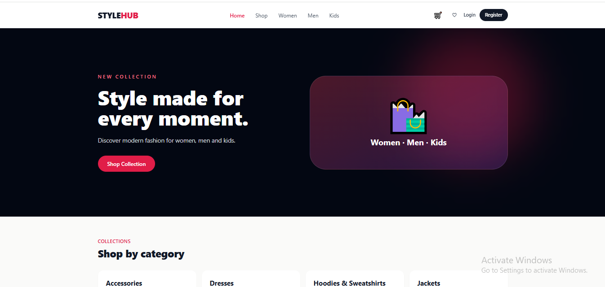
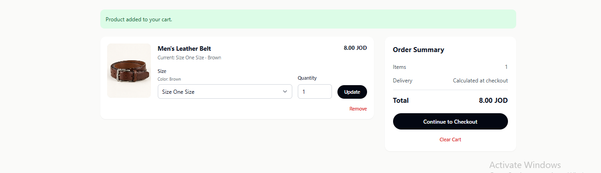
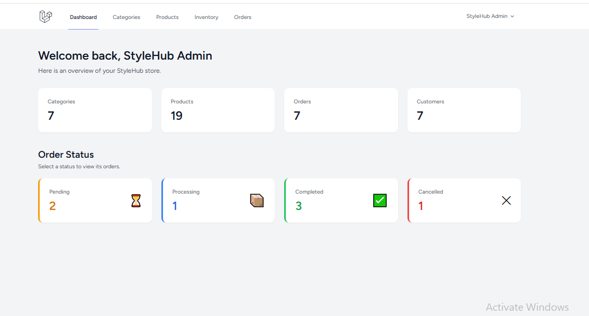

# Style — Laravel E-Commerce Application

An e-commerce web application built with Laravel as a graduation project at Robotna (final score: 91). It covers the full shopping flow for customers and a dashboard for administrators.

## Features

- **Product management:** create, edit, delete and browse products.
- **Shopping cart:** add and remove products and update quantities.
- **Orders:** place orders and track them.
- **Admin dashboard:** manage products and orders from one place.
- **Role-based access:** three roles — admin, user and guest — each with its own permissions.

## Tech Stack

| Layer | Technology |
| --- | --- |
| Backend | PHP, Laravel |
| Frontend | Blade, Tailwind CSS, Vite |
| Database | MySQL |

## Screenshots





## Getting Started

### Requirements

- PHP 8.2 or higher
- Composer
- Node.js and npm
- MySQL

### Installation

```bash
git clone https://github.com/batool-hamd592/style.git
cd style

composer install
npm install

cp .env.example .env
php artisan key:generate
```

Set your database details in `.env` (`DB_DATABASE`, `DB_USERNAME`, `DB_PASSWORD`), then run:

```bash
php artisan migrate
npm run dev
php artisan serve
```

Open `http://localhost:8000` in your browser.

## Roles

| Role | Can do |
| --- | --- |
| Guest | Browse products |
| User | Browse, use the cart and place orders |
| Admin | Everything above, plus manage products and orders from the dashboard |

## My Role

I worked on both the front end and the back end of the project.

## Author

**Batool Hamad** — Full-Stack Web Developer
[GitHub](https://github.com/batool-hamd592) · [LinkedIn](http://www.linkedin.com/in/batool-hamd-285050364)
